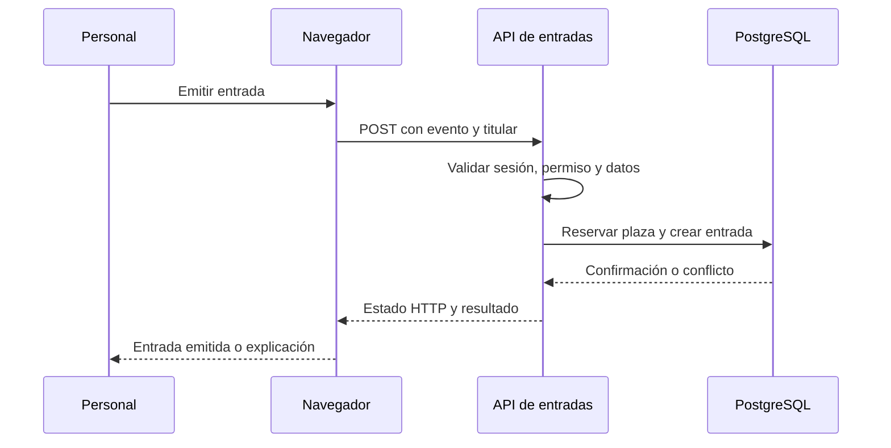

# Clase 1 — Introducción, entorno y trabajo colaborativo

[[README|Inicio]] · [[Semana1/0 INDICE|Semana 1]] · [[Semana1/CLASE 2|Clase 2]] →

> [!abstract] Objetivo
> Comprender el proyecto, abrir los apuntes en Obsidian y colaborar mediante ramas y PR.

## Antes de empezar

Requisitos: JavaScript, HTML y CSS; terminal básica. No se presupone React ni TypeScript. Consulta [[Recursos/Stack y entorno|Stack y entorno]] y [[Proyecto/1. Sistema de Gestion de Discoteca|Proyecto Discoteca]].

## Desarrollo de la clase

### Qué significa desarrollar una aplicación fullstack

Una aplicación web coordina una interfaz que recibe acciones y un sistema que conserva y protege información. En la discoteca, pulsar «Emitir entrada» solo inicia la operación: el sistema debe identificar al empleado, comprobar que el evento está abierto, reservar una plaza, crear la entrada y confirmar qué ocurrió. Si la pantalla muestra éxito antes de comprobar eso, la interfaz y la realidad pueden contar historias distintas.

**Frontend** es la parte que presenta información y permite interactuar. Gestiona formularios, navegación, estados de carga y errores comprensibles. **Backend** recibe peticiones, valida datos, aplica permisos y ejecuta reglas del negocio. **Base de datos** conserva registros y restricciones aunque cierres el navegador. No es un array que vive mientras el programa está encendido.

Next.js permite colocar código de interfaz y de servidor en un mismo proyecto. Eso facilita compartir tipos y organizar funcionalidades, pero las responsabilidades siguen siendo distintas. Que un archivo esté en el mismo repositorio no significa que el navegador deba recibirlo: las credenciales y consultas privadas pertenecen al servidor.

### Un recorrido que volveremos a utilizar



El navegador es un cliente, no una autoridad sobre precios, roles o capacidad. Puede equivocarse, perder conexión o enviar una petición modificada. Por eso la comprobación del backend es necesaria incluso cuando el formulario ya valida.

Si dos clientes intentan comprar la última entrada, la base y la operación del servidor deben decidir un único resultado válido. Más adelante veremos cómo. Hoy interesa identificar quién decide cada cosa y seguir el recorrido sin confundir una pantalla con el sistema completo.

### El proyecto y el MVP

Un MVP es una versión pequeña que permite completar los recorridos esenciales. Nuestro sistema tiene personal, eventos, entradas, bebidas, ventas y reservas. No incluye todos los comportamientos de una discoteca real: por ejemplo, registrar una venta no procesa un pago bancario. Esos límites permiten terminar flujos reales y explicar las decisiones.

Cada tarea se desarrolla como una funcionalidad vertical: sus contratos, backend y componentes de interfaz se relacionan por el comportamiento que ofrecen. La enseñanza avanza primero por backend y después por frontend. Así puedes aprender cada entorno con calma y conservar la misma organización al conectar ambos.

El resultado que buscamos no es solo «arranca en mi máquina». Otro compañero debe poder instalarlo, comprender las variables necesarias, preparar datos de prueba y ejecutar un recorrido con permisos correctos.

### El recorrido del curso

Primero construimos backend (semanas 1–2), después interfaz (semana 3) y finalmente integramos, desplegamos y trabajamos con IA (semana 4). No repasaremos JavaScript, HTML ni CSS.

Una petición recorre navegador → ruta HTTP → servicio de una funcionalidad → PostgreSQL → respuesta. En esta etapa no necesitamos construir componentes de React.

### Obsidian desde el primer día

Instala [Obsidian](https://obsidian.md/download), clona este repositorio y elige **Abrir carpeta como bóveda**. Abre `README.md`, después el índice de la semana. Activa enlaces salientes, backlinks, esquema y grafo local. No se necesitan plugins comunitarios para seguir el curso.

Los enlaces de notas como `[[Semana1/CLASE 1|nombre legible]]` conectan temas; los bloques de información destacan objetivos y errores. Consulta [[Recursos/Obsidian - Guia del curso|Cómo recorrer y ampliar los apuntes]]. Los dibujos Excalidraw son complementarios y requieren su plugin si se quieren editar.

### Crear la aplicación del grupo

Estos apuntes se consultan desde la bóveda. Para programar, trabaja en **el repositorio de aplicación** del grupo y sigue [[Recursos/Stack y entorno|las versiones y comandos comunes]]. Si estudias por tu cuenta, crea esa aplicación en otra carpeta con la receta enlazada. Su página inicial puede permanecer mientras construyes el backend. Tu aporte pertenece a una funcionalidad vertical de la discoteca.

### Flujo mínimo de Git

```bash
git clone URL_DEL_REPOSITORIO_DE_APLICACION
cd discoteca
git switch main
git pull --ff-only
git switch -c feat/events-create
```

Después de trabajar: revisar `git diff`, seleccionar archivos, hacer commit y push. Abrir PR hacia `main`; un compañero revisa y el instructor integra. No usamos una rama `dev` adicional en este curso.

```bash
git add src/features/events
git commit -m "feat: agrega contrato de eventos"
git push -u origin feat/events-create
```

`git add` debe mencionar los archivos que realmente existan en la tarea. Ante un conflicto, hablar con quien modificó la misma zona y verificar el resultado; no aceptar ambas versiones sin leerlas.

### Git explicado con una tarea pequeña

Un repositorio registra cambios de archivos. Tu copia local y GitHub no son la misma ubicación: un commit guarda una versión local; `push` la publica en el remoto. Si todavía no hiciste commit, subir una rama no conserva mágicamente lo que hay en tu editor.

El directorio de trabajo contiene tus archivos actuales. El área de preparación, o staging, reúne los cambios que quieres incluir en el siguiente commit. Esta distinción permite corregir dos cosas y publicarlas por separado cuando resuelven problemas diferentes.

Supón que añades el contrato de eventos:

1. Sincroniza `main` y crea una rama descriptiva.
2. Edita el archivo de tu funcionalidad.
3. Ejecuta `git status` para ver qué cambió y `git diff` para leer el contenido del cambio.
4. Añade ese archivo con `git add RUTA_REAL` y comprueba `git diff --staged`.
5. Crea un commit que explique el resultado y publica tu rama.
6. Abre un Pull Request con contexto y una forma de comprobarlo.

Una rama es una referencia a una línea de trabajo; no necesita duplicar todo el proyecto en otra carpeta. Un PR permite discutir la integración de una rama y revisar su diferencia respecto de la base. No es una garantía automática de calidad: alguien debe leer y comprobar el cambio.

### Qué escribir en el primer PR

Explica qué problema resuelve, qué archivo agregaste y cómo comprobarlo. Por ejemplo: «Define el contrato de creación de eventos, limita el nombre y exige capacidad positiva. Se probó un evento válido y otro sin nombre». Esta descripción ayuda mucho más que «subo lo que hice».

Si otra persona modifica el mismo contrato, pueden aparecer conflictos al integrar. Git marca zonas que no puede combinar con seguridad. Lee ambas intenciones, acuerda el resultado y vuelve a comprobar el código. Aceptar las dos versiones sin revisar puede duplicar funciones o conservar condiciones incompatibles.

### Herramientas y archivos que conviene distinguir

Node.js ejecuta herramientas y código JavaScript fuera del navegador. npm instala dependencias y ejecuta scripts del proyecto. VS Code es el editor; no reemplaza ni al runtime ni a Git. Obsidian organiza estos apuntes: su bóveda es una carpeta con Markdown y enlaces, no el repositorio donde se ejecuta la aplicación.

`package.json` describe el proyecto y sus scripts. `package-lock.json` registra el árbol resuelto de dependencias para repetir una instalación. `.env` contiene configuración local, incluyendo secretos. `.env.example` describe los nombres necesarios con valores ficticios. El primero no se publica; el segundo sí ayuda a preparar el entorno.

### Cómo estudiar una clase y detectar un bloqueo

Antes de copiar código, identifica el archivo, su responsabilidad y la entrada que espera. Después cambia un dato y predice la respuesta. Si el resultado sorprende, anota la petición, el mensaje completo y la diferencia entre lo esperado y lo obtenido. Una captura que solo dice «no funciona» deja demasiadas causas abiertas.

En Obsidian enlaza la duda a su clase y registra cómo la resolviste. El objetivo de un apunte personal no es repetir cada párrafo, sino conservar ejemplos, decisiones y errores que quieras reconocer la próxima vez. Revisa los criterios al terminar y usa el índice para volver a los conceptos relacionados.

### Caso desarrollado: «el botón dice éxito, pero no hay entrada»

El personal completa titular y evento y pulsa emitir. La pantalla muestra una tarjeta verde, pero el listado sigue vacío. Para investigar, separa la intención en fronteras: ¿se ejecutó el handler del botón?, ¿salió una petición?, ¿qué respondió la API?, ¿el servidor escribió?, ¿la interfaz interpretó la respuesta correcta?

En la pestaña Network, una petición ausente apunta primero a la interacción. Una respuesta 400 indica que la API recibió algo y rechazó sus datos. Una respuesta 201 con una entrada persistida, pero listado antiguo, apunta a sincronización de interfaz. Estos resultados no son intercambiables y requieren correcciones diferentes.

No empieces cambiando tres carpetas a la vez. Elige una observación que reduzca posibilidades. Por ejemplo, anota método, ruta y estado sin publicar cookies. Si la base confirmó la entrada, no vuelvas a pulsar emitir para «ver si aparece»: podrías crear otra operación. Primero consulta lo ya confirmado.

Esta forma de seguir fronteras es parte del trabajo fullstack. Conocer todo el stack no significa memorizar cada función, sino comprender dónde se toma una decisión y qué evidencia puedes obtener de ella. Guarda en Obsidian el recorrido y enlázalo a la clase de consumo de API cuando llegues allí.

Para tu primer PR, documenta un recorrido esperado de tu funcionalidad con actor, datos de entrada, resultado y un rechazo. Aunque todavía no exista código, ese contrato permite que el equipo discuta el mismo comportamiento.

## Práctica guiada

Abrir la bóveda; localizar proyecto, tareas e índice. Crear el repositorio de aplicación y el primer PR de documentación.

## Tarea para casa

Leer el proyecto, elegir funcionalidad y acordar compañeros. Instalar entorno y documentar cómo ejecutar el proyecto. No subir secretos.

## Criterios de finalización

- [ ] Puedes recorrer los apuntes mediante enlaces.
- [ ] Existe una rama y un PR revisable.
- [ ] Cada integrante identifica su tarea vertical.

## Preguntas resueltas

**¿Next.js elimina la separación cliente/servidor?**

No. Reúne herramientas en un proyecto, pero el servidor conserva sus secretos y autoridad; el navegador presenta la interacción.

**¿Un commit ya está en GitHub?**

Solo después de publicar el historial con push. Guardar el archivo, hacer commit y publicar son pasos diferentes.

**¿Qué compruebo antes de pedir ayuda?**

Archivo y comando exactos, resultado esperado, mensaje real y pasos para reproducirlo sin incluir credenciales.

## Para profundizar

[Git](https://git-scm.com/doc) · [Obsidian](https://help.obsidian.md/).

## Conceptos clave de esta clase

- **Repositorio:** Carpeta cuyo historial de cambios administra Git.
- **Commit:** Versión registrada de un conjunto de cambios preparados.
- **Remoto:** Repositorio con el que intercambias historial, por ejemplo en GitHub.
- **PR:** Propuesta de integrar una rama después de revisar su diferencia.
- **MVP:** Versión con recorridos esenciales y límites explícitos.
- **Bóveda:** Carpeta de notas que Obsidian abre e interconecta.

## Conexiones

[[Recursos/Obsidian - Guia del curso|Obsidian]] · [[Proyecto/3. Guía de Contribución y Estándares del Proyecto|Contribución]] · [[Proyecto/2. Tareas por funcionalidad|Asignaciones]] · [[Proyecto/4. Arquitectura vertical y contratos|Arquitectura vertical]] · [[Proyecto/5. Evaluacion y entregables|Evaluación y entregables]]


---

[[README|Inicio]] · [[Semana1/0 INDICE|Semana 1]] · [[Semana1/CLASE 2|Clase 2]] →
