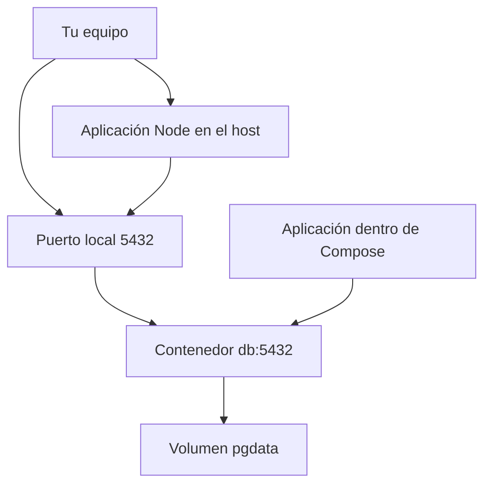

# Clase 3 — Docker I - PostgreSQL local

[[README|Inicio]] · [[Semana1/0 INDICE|Semana 1]] · ← [[Semana1/CLASE 2|Clase 2]] · [[Semana1/CLASE 4|Clase 4]] →

> [!abstract] Objetivo
> Levantar PostgreSQL reproduciblemente y conservar los datos aunque se recree el contenedor.

## Antes de empezar

Repasa [[Semana1/CLASE 2|Clase 2]] y completa su tarea. Consulta [[Recursos/Stack y entorno|Stack y entorno]] y [[Proyecto/1. Sistema de Gestion de Discoteca|Proyecto Discoteca]].

## Desarrollo de la clase

### Qué problema intentamos repetir de forma fiable

La aplicación necesita una versión concreta de PostgreSQL, un usuario, una base y un puerto. Instalar cada pieza manualmente puede producir diferencias entre equipos. Docker permite ejecutar el proceso de PostgreSQL a partir de una imagen conocida y describir su configuración junto al proyecto.

El cliente `docker` envía órdenes a un motor que gestiona imágenes, redes, contenedores y volúmenes. Tener el comando instalado no garantiza que el motor esté disponible: `docker version` debe mostrar cliente y servidor. Si falla la conexión, primero revisa el servicio o contexto, no el código de Prisma.

### Imagen frente a contenedor

Una imagen contiene el sistema de archivos y la configuración inicial para ejecutar un proceso. Un contenedor es una instancia de ejecución de esa imagen con su propia capa escribible. Puedes crear más de un contenedor de una misma imagen con distinta configuración.

Detener no es eliminar. Un proceso detenido puede volver a arrancarse; un contenedor eliminado se recrea desde la configuración. Como queremos conservar los datos incluso después de recrearlo, la carpeta de datos de PostgreSQL se conecta a un volumen nombrado.

La etiqueta `postgres:16-alpine` selecciona la línea 16 y una variante de imagen. No inmoviliza el contenido para siempre como lo haría un digest; en el curso mantenemos la familia acordada y revisamos actualizaciones compatibles. Cambiar a otra versión mayor con un volumen existente no es una actualización trivial de datos.

### Redes: desde dónde haces la conexión



Desde el host, la aplicación se conecta a `localhost:5432`. Desde otro contenedor del mismo proyecto Compose, se conecta a `db:5432`, porque `localhost` allí significa ese otro contenedor. El volumen guarda archivos; no es una dirección para conectarse con SQL.

El mapeo `127.0.0.1:5432:5432` publica el puerto solo en la interfaz local del host. A la izquierda está el puerto del host; a la derecha el puerto interno. Si publicas `5433:5432`, PostgreSQL sigue escuchando dentro en 5432, pero tus herramientas del host usan 5433.

### Imagen, contenedor y volumen

La imagen es la plantilla; el contenedor ejecuta un proceso; el volumen conserva datos fuera de la capa efímera del contenedor. Docker no es una máquina virtual completa. Docker Compose describe los servicios del entorno.

Instalar Docker Engine y el plugin Compose en Linux siguiendo [la guía oficial](https://docs.docker.com/engine/install/); en Windows/macOS usar la instalación oficial adecuada al equipo. No copiar un repositorio Debian con nombre de versión distinto al sistema real. Verificar:

```bash
docker version
docker compose version
```

En Linux, el grupo `docker` permite operaciones con privilegios equivalentes a root; no es solo una comodidad inocua. Si Docker Desktop está activo, seleccionar el contexto correcto.

### compose.yaml de la aplicación

```yaml
services:
  db:
    image: postgres:16-alpine
    environment:
      POSTGRES_USER: ${POSTGRES_USER:?define POSTGRES_USER}
      POSTGRES_PASSWORD: ${POSTGRES_PASSWORD:?define POSTGRES_PASSWORD}
      POSTGRES_DB: ${POSTGRES_DB:?define POSTGRES_DB}
    ports:
      - "127.0.0.1:5432:5432"
    volumes:
      - pgdata:/var/lib/postgresql/data
    healthcheck:
      test: ["CMD-SHELL", "pg_isready -U $$POSTGRES_USER -d $$POSTGRES_DB"]
      interval: 5s
      timeout: 5s
      retries: 10
volumes:
  pgdata:
```

Crear `.env` con valores locales propios, siguiendo [[Recursos/Stack y entorno|la plantilla de entorno]]. Los valores reales no se versionan.

```bash
docker compose up -d db
docker compose ps
docker compose logs db
docker compose exec db sh -c 'psql -U "$POSTGRES_USER" -d "$POSTGRES_DB"'
docker compose down
```

`down` conserva el volumen. `down -v` lo elimina: no lo uses como forma habitual de reiniciar. Si el puerto 5432 está ocupado, publicar 5433 y actualizar la URL local. Cambiar una contraseña en `.env` no cambia automáticamente la de una base ya inicializada.

La aplicación se ejecuta por ahora en el host: `DATABASE_URL` utiliza `localhost`. Dentro de Compose utilizará `db`; lo retomamos en la clase 17.

### Leer Compose sin aprender comandos de memoria

`services` agrupa procesos del entorno. `db` es el nombre del servicio y su nombre dentro de la red. `image` indica de qué plantilla se crea. `environment` entrega configuración al proceso; `ports` publica acceso al host; `volumes` conecta almacenamiento persistente.

La sintaxis `${VARIABLE:?mensaje}` exige una variable y explica su ausencia. Compose lee su `.env` para interpolar el archivo. Eso no significa que cualquier variable del archivo llegue automáticamente a todo contenedor: el servicio recibe las que declaras en `environment` o `env_file`.

El healthcheck ejecuta una comprobación dentro del contenedor. `$$` evita que Compose sustituya demasiado pronto la variable: queremos que el shell interno lea el usuario de PostgreSQL. Un estado running indica proceso iniciado; healthy indica que la comprobación configurada está pasando. Aun así, la aplicación debe manejar fallos de conexión posteriores.

### Laboratorio de persistencia, paso a paso

Después de arrancar la base y abrir `psql`, puedes crear un dato de diagnóstico separado de las tablas del proyecto:

```sql
CREATE TABLE IF NOT EXISTS connection_probe (
  id integer PRIMARY KEY,
  message text NOT NULL
);
INSERT INTO connection_probe (id, message)
VALUES (1, 'La base sigue aquí')
ON CONFLICT (id) DO UPDATE SET message = EXCLUDED.message;
SELECT id, message FROM connection_probe;
```

Sal de `psql` con `\q`, ejecuta `docker compose down` y vuelve a arrancar `db`. Consulta otra vez la tabla. Si aparece la misma fila, has comprobado persistencia tras recreación. Una vez terminado, elimina solo esta tabla de diagnóstico con `DROP TABLE connection_probe;`; las tablas del producto se gestionarán con migraciones.

No uses `down -v` para este experimento: justamente quitaría el volumen que queremos conservar. Tampoco borres volúmenes de otros proyectos al intentar liberar un puerto.

### Diagnosticar los fallos más comunes

| Síntoma | Causa que debes comprobar | Siguiente acción |
| --- | --- | --- |
| Cannot connect to Docker daemon | Motor detenido o contexto equivocado | Revisar servicio/contexto y docker version |
| Port is already allocated | Otro proceso publica ese puerto | Cambiar puerto del host y URL local |
| Password authentication failed | Usuario o contraseña no coinciden | Revisar URL y credenciales de la base inicializada |
| Connection refused | Dirección, puerto o disponibilidad incorrectos | Revisar ps, logs y healthcheck |
| Base vacía tras recrear | Se cambió/eliminó volumen o proyecto Compose | Identificar el volumen usado antes de escribir más datos |

Cambiar `POSTGRES_PASSWORD` en un archivo no cambia la contraseña de una base ya creada. Las variables de inicialización se aplican al preparar el directorio de datos vacío. No destruyas el volumen por esa confusión: identifica la cuenta y modifica su contraseña mediante un procedimiento explícito si necesitas hacerlo.

### Qué se publica y qué se conserva localmente

Versionamos Compose y `.env.example`, porque describen el entorno. El `.env` real y los archivos internos del volumen quedan locales. No hay que subir una base binaria a Git para que un compañero tenga datos: posteriormente usaremos migraciones y seed para reconstruir una base de prueba.

### Caso desarrollado: funciona en el host y falla dentro de Docker

La aplicación del host usa `postgresql://...@localhost:5432/discoteca` y conecta. Al moverla a Compose, la misma URL devuelve conexión rechazada. PostgreSQL sigue healthy y el puerto parece correcto. La diferencia está en quién interpreta localhost.

Dentro de web, localhost es web, no db ni tu computadora. Cambia únicamente la URL de ese servicio a `db:5432`, conservando usuario, contraseña y nombre de base correctos. La URL del host puede seguir usando localhost. No cambies el puerto interno a 5433 solo porque publicaste 5433 para acceder desde tu equipo.

Antes de cambiar código de Prisma, confirma el servicio de destino y revisa logs. Si después del cambio aparece authentication failed en lugar de connection refused, has avanzado: ahora alcanzas un servidor que rechaza la credencial. No son dos mensajes para la misma causa.

Si cambiaste la contraseña en `.env` y usas un volumen anterior, recuerda que la base ya fue inicializada con otra. No reinicialices por accidente para que coincida el ejemplo. Identifica el entorno, corrige la credencial de conexión o realiza un cambio controlado de contraseña.

Documenta por separado las URLs del host y de Compose. El nombre DATABASE_URL_DOCKER del curso hace visible esa diferencia, pero quien ejecuta Prisma en el host debe seguir usando la URL accesible desde allí.

## Práctica guiada

Crear la base, insertar un dato con SQL y comprobar que sigue después de down/up.

## Tarea para casa

Documentar comandos y solucionar un conflicto de puerto sin borrar datos. Subir compose.yaml y .env.example.

## Criterios de finalización

- [ ] La base aparece healthy.
- [ ] El volumen conserva datos.
- [ ] Puedes explicar localhost frente al nombre db.

## Preguntas resueltas

**¿Por qué db no funciona desde mi terminal del host?**

Ese nombre se resuelve entre servicios de la red Compose; desde el host se usa el puerto publicado.

**¿Running significa listo para aceptar SQL?**

No necesariamente. Revisa la comprobación de salud y una conexión real.

**¿Puedo arreglar una contraseña borrando el volumen?**

Borrarlo destruye datos. La solución es revisar o cambiar credenciales de manera explícita, no reinicializar por accidente.

## Para profundizar

[Docker Compose](https://docs.docker.com/compose/) · [Orden y salud](https://docs.docker.com/compose/how-tos/startup-order/).

## Conceptos clave de esta clase

- **Host:** Equipo o entorno desde el que se ejecuta Docker.
- **Daemon:** Proceso del motor que atiende al cliente Docker.
- **Puerto:** Punto de conexión de red asociado a un servicio.
- **Volumen:** Almacenamiento gestionado fuera de la capa efímera del contenedor.
- **Healthcheck:** Comprobación periódica configurada para evaluar disponibilidad.
- **Contexto:** Configuración que indica a qué motor se dirige el cliente Docker.

## Conexiones

[[Recursos/Docker/Docker|Mapa de Docker]] · [[semana4/CLASE 17|Clase 17]] · [[Proyecto/4. Arquitectura vertical y contratos|Arquitectura vertical]] · [[Proyecto/5. Evaluacion y entregables|Evaluación y entregables]]


---

[[README|Inicio]] · [[Semana1/0 INDICE|Semana 1]] · ← [[Semana1/CLASE 2|Clase 2]] · [[Semana1/CLASE 4|Clase 4]] →
