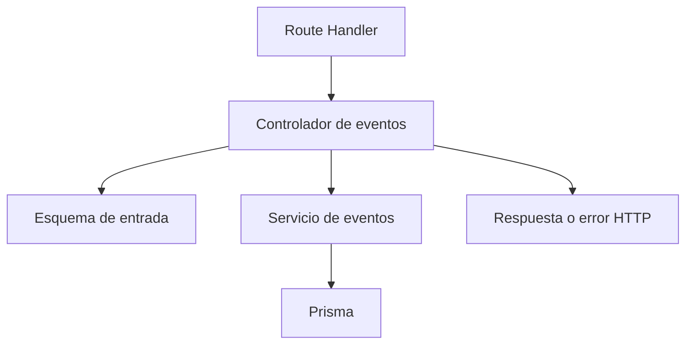

# Clase 5 — HTTP, REST y primera funcionalidad vertical

[[README|Inicio]] · [[Semana1/0 INDICE|Semana 1]] · ← [[Semana1/CLASE 4|Clase 4]] · [[Semana2/CLASE 6|Clase 6]] →

> [!abstract] Objetivo
> Construir una ruta HTTP pequeña usando arquitectura vertical y validación en ejecución.

## Antes de empezar

Repasa [[Semana1/CLASE 4|Clase 4]] y completa su tarea. Consulta [[Recursos/Stack y entorno|Stack y entorno]] y [[Proyecto/1. Sistema de Gestion de Discoteca|Proyecto Discoteca]].

## Desarrollo de la clase

### HTTP: la conversación entre cliente y servidor

HTTP define cómo intercambiar peticiones y respuestas. Una petición incluye método, dirección, cabeceras y, cuando corresponde, cuerpo. La respuesta incluye estado, cabeceras y contenido. No es necesario usar React para observar esta conversación: curl y las herramientas de red del navegador permiten inspeccionarla directamente.

En `POST /api/events`, el método indica intención y la ruta identifica el recurso. Una cabecera `Content-Type: application/json` describe el formato del cuerpo. El JSON contiene datos, no código TypeScript; los tipos de tu editor no viajan dentro de la petición.

Una URL puede tener parámetros de ruta y de consulta. `/api/events/ID` identifica un evento; `/api/events?status=OPEN` expresa un filtro. Un fragmento después de `#` se interpreta en el cliente y no sirve para pasar parámetros al servidor HTTP.

### Recursos y operaciones REST

REST organiza el acceso alrededor de recursos con representaciones. No significa que toda función del negocio tenga que parecer una tabla. «Registrar ingreso» es una acción con reglas y puede expresarse como `POST /api/admissions/ID/check-in`.

GET consulta y no debe causar cambios del negocio. POST crea o ejecuta acciones; PATCH comunica cambios parciales. PUT expresa reemplazo según el contrato definido, por eso no lo tratamos como un sinónimo automático de PATCH. DELETE representa eliminación donde el producto la permite. En el MVP no borramos ventas para simular que nunca ocurrieron.

Los métodos y estados expresan intención, pero necesitas implementar sus garantías. Poner una operación repetible bajo PUT no la vuelve correcta si su servicio duplica una venta. El servidor debe sostener la semántica acordada.

### Leer el resultado sin adivinar

| Estado | Qué comunica en nuestros ejemplos |
| --- | --- |
| 200 | Consulta o cambio completado con respuesta |
| 201 | Recurso creado |
| 204 | Operación exitosa sin cuerpo de respuesta |
| 400 | Petición o datos inválidos |
| 401 | No hay una sesión válida |
| 403 | No se permite esa operación |
| 404 | No se encontró el recurso solicitado |
| 409 | Conflicto con estado o unicidad |
| 500 | Fallo inesperado del servidor |

Un cuerpo con `{ "error": "..." }` y estado 200 confunde a los consumidores. El estado debe corresponder con lo ocurrido. Tampoco prometas que todo error es del usuario: si la base no está disponible, corregir el nombre del evento no solucionará nada.

### Contrato antes de implementación

Un contrato define campos permitidos, tipos, límites, representación de fechas, permisos, errores y forma de respuesta. El campo `capacity` no solo es number: acordamos entero entre 1 y 10000. El nombre se recorta antes de medir su longitud. La fecha incluye zona y se valida su formato; decidir si debe ser futura es otra regla del producto.

### Contrato HTTP

GET consulta, POST crea, PATCH modifica parcialmente y DELETE elimina según la política acordada. Usamos 200/201 para éxito, 400 para entrada inválida, 401 sin sesión, 403 sin permiso, 404 inexistente y 409 por conflicto. Un JSON mal formado también es 400.

En Next.js las rutas viven en `src/app/api`, pero la lógica pertenece a `src/features/<funcionalidad>`. Revisar [[Proyecto/4. Arquitectura vertical y contratos|el árbol y las dependencias]].

### Esquema y contrato

Instalar `zod@4`. Crear `src/features/events/shared/event.schema.ts`:

```ts
import { z } from "zod";
export const createEventSchema = z.object({
  name: z.string().trim().min(3).max(100),
  startsAt: z.iso.datetime({ offset: true }),
  capacity: z.number().int().min(1).max(10000),
}).strict();
export type CreateEventInput = z.infer<typeof createEventSchema>;
```

Nunca aceptar `role`, `totalCents`, contadores o IDs del usuario autenticado porque el cliente los envíe. Cada endpoint define sus campos permitidos.

### Primera ruta sin base de datos

```ts
// src/app/api/health/route.ts
export async function GET() {
  return Response.json({ status: "ok" });
}
```

```bash
curl -i http://localhost:3000/api/health
```

La ruta de salud no consulta información del negocio. Las operaciones de escritura se desarrollan y prueban solo localmente hasta integrar los permisos de las clases 8–9.

### Validar antes de persistir

```ts
const body: unknown = await request.json();
const input = createEventSchema.parse(body);
```

El controlador transforma HTTP; el servicio aplica reglas y usa Prisma. El esquema puede compartirse con el frontend; el servicio de base de datos nunca se importa allí.

### Apoyo visual: el viaje de una petición

![[pasosPeticion.excalidraw]]

[[pasosPeticion.excalidraw|Abrir el dibujo del recorrido de una petición]] · [[Recursos/Mapa de dibujos Excalidraw|Ver todos los dibujos]].

Sigue las flechas desde el cliente: el JSON llega a una ruta y su handler/controlador, pasa por el contrato de datos y alcanza el servicio. El servicio utiliza Prisma para comunicarse con la base relacional; el resultado vuelve hasta la respuesta que recibe el cliente.

El dibujo separa responsabilidades; no exige crear un archivo independiente por cada caja. En nuestra arquitectura, la ruta está en `app/api` y los contratos, controladores y servicios se agrupan dentro de su funcionalidad. Localiza dónde rechazarías un dato mal formado, un permiso insuficiente y una reserva duplicada: no son la misma comprobación.

### Un recorrido verificable con curl

Con el servidor de desarrollo ejecutándose, consulta la ruta de salud. `-i` muestra cabeceras y estado. Después de construir el controlador en la siguiente clase, la petición de creación tendrá esta forma:

```bash
curl -i http://localhost:3000/api/events \
  -H 'Content-Type: application/json' \
  -H 'Origin: http://localhost:3000' \
  -d '{"name":"Noche Disco","startsAt":"2026-12-05T22:00:00-04:00","capacity":100}'
```

El ejemplo describe la API local en construcción. Cuando agregues autenticación, la misma petición sin sesión deberá devolver 401; no elimines permisos para que el comando vuelva a crear registros. Una cabecera Origin tampoco es una identidad: sirve a otra comprobación que estudiaremos en seguridad.

Prueba variantes una por una: nombre vacío, capacidad como texto, campo inesperado y JSON con una coma mal colocada. Son fallos distintos. El último ni siquiera produce un objeto válido; los anteriores sí producen JSON, pero incumplen el contrato.

### Zod como frontera de confianza

`parse` devuelve datos validados o lanza un error. `safeParse` devuelve un resultado con éxito o fallos para que lo trates explícitamente. La opción strict rechaza campos extra; ayuda a no aceptar privilegios o valores internos que el cliente invente.

No construyas el objeto Prisma directamente con el body. Primero identifica qué campos públicos acepta la operación; luego aplica reglas y fija en servidor los valores internos. Un usuario no se vuelve administrador porque su petición incluya `role: "ADMIN"`.

### Arquitectura vertical sin confundir capas con dominios



La ruta conecta una dirección con un controlador. El controlador interpreta HTTP y delega. El servicio aplica un comportamiento del negocio. La validación de datos compartida no necesita saber de cookies ni de Prisma. Todo esto puede vivir dentro de `features/events`, mientras la ruta queda en `app/api/events` por la convención de Next.js.

No hace falta crear una capa para cada línea. La separación es útil cuando permite entender responsabilidades, probar reglas y evitar que una modificación de la pantalla cambie la persistencia por accidente. Un CRUD sencillo puede tener pocas funciones bien nombradas.

### Límites de la ruta de salud

Una respuesta `/api/health` con status ok prueba que esa ruta responde. No demuestra que todos los servicios estén sanos ni que la base acepte consultas. Evita publicar detalles internos, versiones privadas o variables. Si añades comprobación de base, decide qué información se expone y cuánto trabajo puede provocar cada consulta de monitoreo.

### Caso desarrollado: un 400 que permite corregir la petición

Envías `{"name":"","capacity":0,"startsAt":"mañana"}`. El JSON está bien formado, así que el parser lo convierte en objeto. El esquema rechaza longitud de nombre, rango de capacidad y formato de fecha. Una respuesta 400 con issues permite relacionar cada error con su campo.

Después envías un cuerpo con una coma final inválida. Esta vez falla el análisis JSON antes de que exista un objeto para Zod. También es un error de petición, pero no deberías atribuirlo a capacity ni fingir que el nombre fue validado.

Ahora usas datos válidos, pero añades `role: "ADMIN"`. El esquema strict rechaza el campo inesperado. Aceptarlo sin usarlo podría tolerarse en otros contratos, pero en este curso preferimos una frontera explícita para detectar desalineaciones y evitar asignaciones accidentales.

Por último, una petición válida sin sesión será 401 después de integrar autenticación. No necesitas cambiar los datos para corregir ese resultado: necesitas acreditar identidad. La misma ruta puede rechazar por causas distintas y el cliente debe poder distinguirlas.

Al documentar un endpoint, escribe un request válido y dos inválidos con sus estados y formas de respuesta. Eso permite desarrollar la pantalla y las pruebas con menos interpretación personal. No basta enumerar GET y POST sin especificar qué significan sus datos.

### Complemento: otras formas de comunicación

[[grpc.excalidraw|El dibujo de gRPC]] utiliza cine y candybar para representar comunicación entre servicios. Puedes compararlo con nuestra API: una llamada remota mediante un contrato de operaciones es otro enfoque de integración. No hace falta dividir la discoteca en microservicios ni implementar gRPC para completar el MVP. En [[Recursos/Mapa de dibujos Excalidraw#Comunicación entre servicios: gRPC|el índice visual]] encontrarás el contexto del ejemplo.

## Práctica guiada

Añadir /api/health, un contrato de evento y un ejemplo válido e inválido.

## Tarea para casa

Definir rutas y contratos de tu módulo. Probar JSON incorrecto y campos inesperados.

## Criterios de finalización

- [ ] Puedes seguir petición, validación y respuesta.
- [ ] El contrato rechaza campos extra.
- [ ] La funcionalidad tiene su propia carpeta.

## Preguntas resueltas

**¿JSON válido significa datos válidos?**

No. Un precio negativo es JSON correcto y puede incumplir el contrato y el dominio.

**¿Un 401 se arregla cambiando el formulario?**

Hay que recuperar una sesión válida; no es el mismo problema que un campo inválido.

**¿Vertical significa todo en un archivo?**

No. Agrupa por funcionalidad y conserva responsabilidades claras dentro de ella.

## Para profundizar

[HTTP en MDN](https://developer.mozilla.org/en-US/docs/Web/HTTP/Overview) · [Zod](https://zod.dev/api) · [Route Handlers](https://nextjs.org/docs/app/getting-started/route-handlers).

## Conceptos clave de esta clase

- **Endpoint:** Combinación de dirección y operación que ofrece una API.
- **Header:** Metadato de una petición o respuesta HTTP.
- **Payload:** Contenido de datos enviado en una operación.
- **JSON:** Formato textual de intercambio; no incluye los tipos de TypeScript.
- **Route Handler:** Función que atiende un método HTTP en App Router.
- **Stateless:** El protocolo no presupone recuerdos de una petición anterior; la identidad debe acreditarse de nuevo.

## Conexiones

[[Proyecto/4. Arquitectura vertical y contratos|Arquitectura y HTTP]] · [[Semana2/CLASE 6|Clase 6]] · [[Proyecto/4. Arquitectura vertical y contratos|Arquitectura vertical]] · [[Proyecto/5. Evaluacion y entregables|Evaluación y entregables]]


---

[[README|Inicio]] · [[Semana1/0 INDICE|Semana 1]] · ← [[Semana1/CLASE 4|Clase 4]] · [[Semana2/CLASE 6|Clase 6]] →
