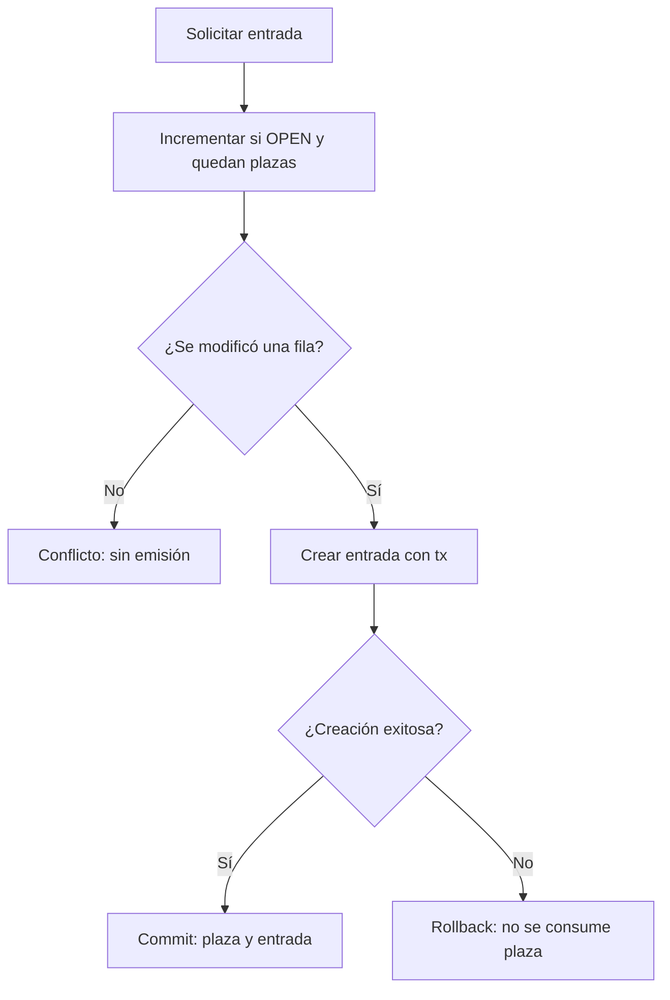

# Clase 7 — Relaciones, reglas de negocio y transacciones

[[README|Inicio]] · [[Semana2/0 INDICE|Semana 2]] · ← [[Semana2/CLASE 6|Clase 6]] · [[Semana2/CLASE 8|Clase 8]] →

> [!abstract] Objetivo
> Hacer cumplir reglas de negocio incluso ante peticiones concurrentes.

## Antes de empezar

Repasa [[Semana2/CLASE 6|Clase 6]] y completa su tarea. Consulta [[Recursos/Stack y entorno|Stack y entorno]] y [[Proyecto/1. Sistema de Gestion de Discoteca|Proyecto Discoteca]].

## Desarrollo de la clase

### Una regla que necesita resistir dos peticiones

Imagina un evento con capacidad 100 y 99 entradas emitidas. Ana y Bruno solicitan la última plaza al mismo tiempo. Si ambos consultan el contador antes de escribir, los dos pueden leer 99 y concluir que hay lugar. El código parece correcto cuando lo recorres una vez, pero falla cuando se intercalan dos ejecuciones.

Esto es una **condición de carrera**: el resultado depende del orden de pasos concurrentes. No hace falta que dos acciones ocurran exactamente en el mismo nanosegundo. Basta con que una petición lea un estado que otra cambia antes de que la primera termine de actuar.

### Atomicidad e invariantes

Una operación atómica se observa como una unidad para la garantía que ofrece. En el ingreso, la condición «todavía no usado» y la escritura de la fecha deben ocurrir juntas. Si separas leer y escribir, dos empleados pueden aprobar la misma entrada.

Un invariante es una propiedad que debe conservarse después de cada operación válida. En emisión: contador entre cero y capacidad. En reserva: a lo sumo una fila para mesa/evento. En venta: el total corresponde a sus líneas y precios registrados. Nombrar invariantes ayuda a decidir dónde aplicar restricciones y qué probar.

### Qué aporta una transacción

Una transacción agrupa operaciones para confirmar todo o deshacerlo si algo falla. Si aumentamos el contador, pero falla crear la entrada, no queremos perder una plaza. Al usar el cliente `tx` dentro del bloque transaccional, ambas escrituras participan del mismo resultado.

ACID resume atomicidad, consistencia, aislamiento y durabilidad. La consistencia no inventa las reglas del negocio: debes expresarlas con restricciones y lógica. El aislamiento controla qué observan operaciones concurrentes; no significa que cualquier secuencia de lecturas y escrituras sea correcta por estar dentro de un bloque.



La comparación usa la capacidad de esa misma fila y el incremento se ejecuta en la base. Esto evita traer un contador a memoria y luego sobrescribirlo con un cálculo basado en una lectura vieja.

### Reglas concretas

- Una entrada corresponde a un evento y solo puede ingresar una vez.
- Una mesa solo tiene una reserva por evento en el MVP.
- La venta de barra usa precios de la base, no el total enviado por el cliente.
- La capacidad del evento debe ser positiva; no emitir más entradas que plazas.

Las validaciones del formulario ayudan a la UX. La garantía pertenece al servidor y, cuando corresponde, a restricciones o actualizaciones atómicas en la base.

### Registro de entrada sin sobreventa

El esquema común contiene `Event.admissionCount`. Toda emisión debe utilizar este servicio; no ofrecer otro endpoint que cree entradas saltándose el contador.

```ts
// src/features/admissions/backend/issue-admission.ts
import "server-only";
import { prisma } from "@/shared/lib/prisma";
import { ApiError } from "@/shared/lib/api-error";
export async function issueAdmission(eventId: string, holderName: string) {
  return prisma.$transaction(async (tx) => {
    const reserved = await tx.event.updateMany({
      where: { id: eventId, status: "OPEN", admissionCount: { lt: tx.event.fields.capacity } },
      data: { admissionCount: { increment: 1 } },
    });
    if (reserved.count !== 1) throw new ApiError(409, "Evento cerrado, inexistente o sin plazas");
    return tx.admission.create({ data: { eventId, holderName } });
  });
}
```

Ambos cambios se confirman juntos. Si falla la creación, el contador vuelve al valor anterior. En el MVP no hay cancelación ni reducción de capacidad después de abrir el evento; añadir esas acciones exigiría nuevas reglas.

### Ingreso una sola vez

```ts
const result = await prisma.admission.updateMany({
  where: { id: admissionId, checkedInAt: null },
  data: { checkedInAt: new Date() },
});
if (result.count !== 1) throw new ApiError(409, "Entrada inexistente o ya utilizada");
```

Dos solicitudes simultáneas no deben producir dos ingresos exitosos. Para reservas, `@@unique([eventId, tableId])` respalda la regla y un conflicto Prisma se traduce a 409.

### Dinero y ventas

Recibir `[{ drinkId, quantity }]`, validar cantidades enteras positivas, agrupar IDs repetidos y consultar bebidas disponibles. El servidor calcula `unitPriceCents * quantity`, verifica enteros seguros y persiste una copia del precio en cada línea. Ese precio histórico no cambia al editar el catálogo.

Usar una transacción para cabecera y líneas. Añadir una clave única de petición para no registrar dos ventas al repetir el envío; misma clave con contenido diferente debe devolver 409. Una transacción por sí sola no aporta idempotencia.

### Leer el servicio línea por línea

`$transaction(async (tx) => ...)` define el conjunto que debe confirmarse. `updateMany` no significa que queramos editar varios eventos: nos permite expresar un filtro que incluye ID, estado y contador, y conocer cuántas filas lo cumplieron.

`tx.event.fields.capacity` referencia otra columna del modelo; no es una variable del navegador. `increment: 1` aumenta el valor en la base. Si count es cero, no hubo reserva de plaza y se lanza un conflicto. Si la creación posterior falla, la transacción deshace el incremento.

No mezcles `prisma.admission.create` fuera de `tx` dentro del callback: esa llamada podría usar una operación que no pertenece a la transacción que crees estar protegiendo. Tampoco hagas peticiones de red lentas mientras conservas bloqueos de base sin una necesidad justificada.

### Unicidad de reservas

La interfaz puede consultar qué mesas parecen disponibles, pero esa imagen envejece. La restricción única compuesta es el árbitro cuando dos clientes intentan reservar la misma mesa y evento. Uno crea; el otro obtiene conflicto.

El mensaje correcto no es «la aplicación se rompió», sino «la mesa ya no está disponible para ese evento». Conserva la selección del evento y permite elegir otra mesa. Este ejemplo conecta integridad del backend con una UX que reconoce cambios ajenos.

### La diferencia entre rollback e idempotencia

Rollback protege de resultados parciales. Idempotencia protege frente a repetir una intención ya procesada. Si una venta se guardó y el navegador perdió la respuesta, el usuario puede reintentar. Sin una clave única, las dos transacciones pueden ser válidas y producir dos ventas completas.

Una requestKey representa la intención de venta. El cliente la conserva para el mismo contenido y el servidor la registra una sola vez. Si ya existe, comprueba actor y contenido antes de devolver el resultado. Misma clave y distinto pedido debe dar conflicto, no modificar en silencio una venta.

El hash canónico del contenido permite comparar intenciones. Agrupar y ordenar líneas evita considerar diferentes dos pedidos que contienen exactamente los mismos productos y cantidades en otro orden. El hash no sustituye la autorización: el servidor también verifica que la venta corresponde al actor permitido.

### Ejemplo numérico de venta

Dos aguas de 1000 centavos y una bebida de 2500 suman `2 * 1000 + 1 * 2500 = 4500` centavos. El cliente puede mostrar Bs 45,00, pero el servidor consulta precios y calcula otra vez. Si el catálogo cambió entre mostrar y confirmar, la respuesta debe comunicar el precio confirmado según la política del producto.

Guardar cada `unitPriceCents` permite reconstruir ese total después. Validar cantidades positivas evita líneas negativas; limitar número de líneas y cantidades evita sumas fuera de rango. Como Prisma Int usa el rango de entero de PostgreSQL, comprobar solo `Number.isSafeInteger` no basta: también debe respetarse el límite del campo persistido.

### Cómo probar una carrera de verdad

Prepara un evento con una plaza restante en una base de prueba. Lanza dos emisiones con sesiones válidas, no en secuencia. Debe haber una entrada nueva y contador igual a capacidad. Inspecciona la base, no solo las respuestas: dos mensajes de error no demostrarían que no se perdió una plaza.

Repite con ingreso único y reserva duplicada. En idempotencia, envía dos veces la misma clave y contenido; después cambia el contenido manteniendo clave. Registra qué garantía comprueba cada caso. La nota [[Recursos/Conceptos/Idempotencia y concurrencia|Idempotencia y concurrencia]] amplía el análisis de reintentos y carreras.

### Caso desarrollado: commit sin respuesta al navegador

El servidor calcula una venta, crea cabecera y líneas y hace commit. Antes de que llegue el JSON, se corta la conexión. El personal ve un error y decide reintentar. En la base ya existe una venta completa; rollback no puede deshacer una transacción que terminó solo porque el cliente no recibió confirmación.

Si el reintento trae una nueva requestKey, la base puede registrar otra venta válida. Si conserva la misma clave y el mismo contenido, el servicio reconoce la intención y devuelve la venta existente. Si hay otra solicitud concurrente, la restricción única en requestKey impide dos cabeceras.

Cuando detectes el conflicto de clave, vuelve a leer y compara actor y hash canónico. No devuelvas la venta a cualquier usuario que adivine o copie una clave. Tampoco aceptes cambiar las cantidades con la misma clave para modificar una venta ya confirmada.

En la interfaz distingue «respuesta desconocida» de «operación rechazada». La primera necesita consultar o reintentar la misma intención. La segunda puede permitir corregir un campo o elegir otro recurso según el estado recibido.

Esta situación muestra por qué los errores de red no deben tratarse como confirmación de que nada ocurrió. Las garantías del backend y el manejo del borrador se diseñan juntos para que recuperar una conexión no duplique datos.

## Práctica guiada

Probar dos intentos de ingreso para una entrada y dos reservas para la misma mesa/evento.

## Tarea para casa

Implementar una regla crítica de tu módulo y documentar sus casos de concurrencia. Para barra, implementar total del servidor e idempotencia.

## Criterios de finalización

- [ ] El ingreso repetido falla.
- [ ] La reserva duplicada produce 409.
- [ ] Los totales no dependen del cliente.

## Preguntas resueltas

**¿Transacción e idempotencia son lo mismo?**

No. Una evita resultados parciales; la otra evita duplicar una intención al reintentar.

**¿Consultar disponibilidad basta para reservar?**

No. La condición debe sostenerse al escribir mediante restricciones u operaciones atómicas.

**¿Por qué no hacer toda la operación con el cliente global?**

Dentro de la transacción debes usar tx para que las consultas formen parte del mismo conjunto.

## Para profundizar

[Prisma 7: transacciones](https://www.prisma.io/docs/orm/v7/prisma-client/queries/transactions) · [PostgreSQL: aislamiento](https://www.postgresql.org/docs/16/transaction-iso.html).

## Conceptos clave de esta clase

- **Invariante:** Propiedad del dominio que todas las operaciones válidas deben conservar.
- **Carrera:** Intercalado de operaciones que puede invalidar una decisión basada en una lectura anterior.
- **Commit:** Confirmación de los cambios de una transacción.
- **Rollback:** Deshacer cambios no confirmados de una transacción fallida.
- **Idempotencia:** Repetir una intención sin duplicar su efecto lógico.
- **Bloqueo:** Mecanismo de coordinación que puede hacer esperar operaciones concurrentes.

## Conexiones

[[Proyecto/6. Modelo de datos|Restricciones del modelo]] · [[Semana2/CLASE 10|Clase 10]] · [[Proyecto/4. Arquitectura vertical y contratos|Arquitectura vertical]] · [[Proyecto/5. Evaluacion y entregables|Evaluación y entregables]]


---

[[README|Inicio]] · [[Semana2/0 INDICE|Semana 2]] · ← [[Semana2/CLASE 6|Clase 6]] · [[Semana2/CLASE 8|Clase 8]] →
