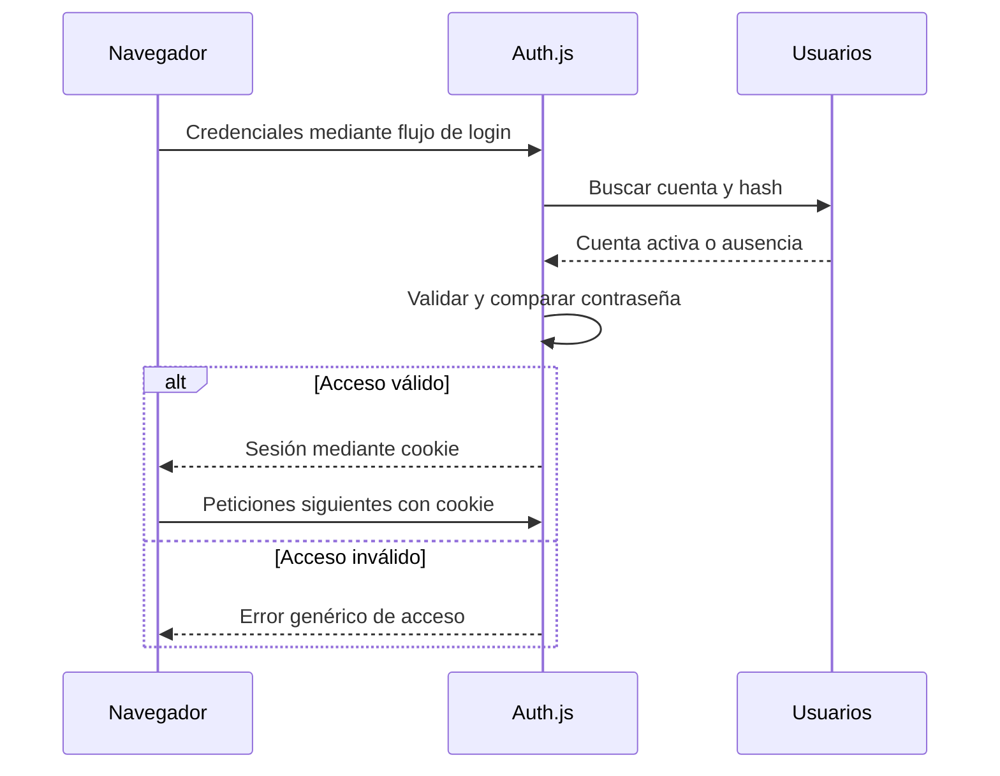

# Clase 8 — Autenticación y sesiones

[[README|Inicio]] · [[Semana2/0 INDICE|Semana 2]] · ← [[Semana2/CLASE 7|Clase 7]] · [[Semana2/CLASE 9|Clase 9]] →

> [!abstract] Objetivo
> Autenticar al personal sin persistir ni devolver contraseñas en texto plano.

## Antes de empezar

Repasa [[Semana2/CLASE 7|Clase 7]] y completa su tarea. Consulta [[Recursos/Stack y entorno|Stack y entorno]] y [[Proyecto/1. Sistema de Gestion de Discoteca|Proyecto Discoteca]].

## Desarrollo de la clase

### Identidad, credenciales y sesión

Autenticar es comprobar una identidad. Las credenciales son evidencia que presenta alguien para acreditarla. En el curso usamos correo y contraseña del personal. Una sesión permite relacionar peticiones posteriores con esa identidad sin volver a pedir la contraseña en cada clic.

La cuenta persiste en la base. La sesión tiene una duración y puede perder validez aunque la cuenta siga existiendo. El navegador conserva la cookie; el servidor verifica su contenido y recupera la identidad. En la siguiente clase consultaremos además si la cuenta sigue activa y qué puede hacer hoy.

### Guardar contraseñas sin poder leerlas de vuelta

No necesitamos recuperar la contraseña original para verificar un acceso. Un algoritmo de hashing de contraseñas produce una representación diseñada para que cada intento de cálculo tenga un coste. El salt evita que contraseñas iguales produzcan representaciones iguales de forma reutilizable entre cuentas.

`bcrypt.hash(password, 12)` incorpora salt y coste. `bcrypt.compare` verifica el intento contra el hash almacenado. No vuelvas a hashear manualmente con un salt nuevo y compares strings: aunque la contraseña sea la misma, el resultado puede ser diferente.

Hashing no es cifrado reversible. Tampoco significa que puedas publicar los hashes sin riesgo: una filtración permite intentar adivinar contraseñas sin pasar por tus límites de login. Por eso no se devuelven en JSON ni se guardan en logs.

La receta usa bcrypt con un límite explícito de 72 bytes UTF-8. Bytes y caracteres no son idénticos: algunos caracteres necesitan varios bytes. La validación debe coincidir entre creación de cuenta y login. En sistemas nuevos también existen alternativas como Argon2id; aquí mantenemos una receta consistente en lugar de mezclar algoritmos sin explicación.

### Cookies y tokens

Una cookie es un mecanismo de almacenamiento y envío del navegador, no un formato de identidad por sí mismo. Puede transportar un identificador opaco o un token. JWT es un formato de token; su protección depende de la implementación. No asumas que siempre puedes leer su contenido ni que solo por llamarse JWT es seguro.

HttpOnly impide leer la cookie desde JavaScript del navegador, Secure restringe su envío a HTTPS y SameSite limita determinados envíos entre sitios. Estas propiedades tienen alcances diferentes. HttpOnly no impide que un script malicioso haga acciones desde la página; por eso veremos XSS y CSRF por separado.

### Decisión del curso

No habrá registro público: el administrador crea cuentas del personal. Usamos credenciales, JWT gestionado por Auth.js y cookies de sesión; no implementamos nuestro propio JWT ni lo guardamos en localStorage.

Los apuntes usan la API de **Auth.js / NextAuth 5 beta**, no los ejemplos `withAuth` de v4. Ver [[Recursos/Stack y entorno|la advertencia de versión y el lockfile]]. Usa la versión exacta registrada en el proyecto y conserva el lockfile; los comandos de instalación de abajo sirven para crear una copia nueva, no para actualizar una existente sin revisión.

```bash
npm install --save-exact next-auth@beta bcryptjs
npx auth secret
```

### Usuarios y contraseñas

El campo se llama siempre `passwordHash`. Al crear una cuenta autorizada, validar contraseña (mínimo 8 caracteres y máximo 72 bytes UTF-8 para este ejemplo bcrypt), aplicar `bcrypt.hash(password, 12)` y usar un `select` público en Prisma. El cliente nunca elige un rol de administrador mediante un registro abierto.

El seed inicial crea una cuenta administrativa con una contraseña leída de una variable local. No hay contraseñas por defecto en el código. Consultar [[Proyecto/6. Modelo de datos|seed del proyecto]].

### Configuración en src/auth.ts

```ts
import NextAuth from "next-auth";
import Credentials from "next-auth/providers/credentials";
import bcrypt from "bcryptjs";
import { z } from "zod";
import { prisma } from "@/shared/lib/prisma";
const loginSchema = z.object({
  email: z.email(),
  password: z.string().min(8).refine((s) => new TextEncoder().encode(s).length <= 72),
});
export const { handlers, auth, signIn, signOut } = NextAuth({
  session: { strategy: "jwt", maxAge: 8 * 60 * 60 },
  providers: [Credentials({
    credentials: { email: {}, password: {} },
    async authorize(raw) {
      const parsed = loginSchema.safeParse(raw);
      if (!parsed.success) return null;
      const user = await prisma.user.findUnique({ where: { email: parsed.data.email.toLowerCase() } });
      if (!user || !user.active) return null;
      if (!await bcrypt.compare(parsed.data.password, user.passwordHash)) return null;
      return { id: user.id, name: user.name, email: user.email };
    },
  })],
  callbacks: {
    jwt({ token, user }) { if (user) token.sub = user.id; return token; },
    session({ session, token }) {
      if (token.sub) session.user.id = token.sub;
      return session;
    },
  },
});
```

Crear `src/types/next-auth.d.ts` para el campo adicional:

```ts
import type { DefaultSession } from "next-auth";
declare module "next-auth" {
  interface Session {
    user: { id: string } & DefaultSession["user"];
  }
}
```

Y `src/app/api/auth/[...nextauth]/route.ts`:

```ts
import { handlers } from "@/auth";
export const { GET, POST } = handlers;
```

`AUTH_SECRET` permanece privado. Mantener los defaults seguros de cookies de la librería y HTTPS en producción. Hashing no es cifrado reversible. HttpOnly dificulta robar la cookie desde JS, pero no elimina XSS ni sustituye protección CSRF.

Antes de publicar: añadir limitación de intentos usando almacenamiento compartido o controles del proveedor de hosting, probar el bloqueo y no registrar credenciales. No basta un contador en memoria en un despliegue con varias instancias.

### Flujo de acceso completo



La librería gestiona endpoints y detalles de su protocolo. Tu función authorize se concentra en validar y comprobar la cuenta. No registres el objeto completo `credentials` para depurar: contiene precisamente el dato que queremos mantener privado.

### Entender los callbacks del ejemplo

El callback jwt conserva el identificador al establecer la sesión. El callback session copia ese identificador a la representación que usa la aplicación. No copiamos passwordHash ni la contraseña. Tampoco convertimos un rol enviado por el formulario en un privilegio confiable.

La ampliación de tipos de Session informa a TypeScript del campo `id`. No crea el valor en ejecución: por eso también existe el callback que lo asigna. Este es un buen ejemplo de la diferencia entre describir un contrato y producir los datos que lo cumplen.

El archivo `[...nextauth]/route.ts` conecta los handlers de Auth.js a su ruta. La configuración y el cliente de Prisma pertenecen al servidor. Más adelante el formulario cliente utilizará las funciones públicas de la librería, no importará `src/auth.ts` para consultar contraseñas.

### Crear la primera cuenta y las siguientes

Como no hay registro público, el primer administrador se prepara mediante variables locales y seed controlado. Después las cuentas de personal se crean con una operación administrativa: validar entrada, aplicar hash, asignar STAFF según el contrato y seleccionar campos públicos.

La unicidad del correo debe acompañarse de una normalización acordada. El ejemplo pasa correos a minúsculas al crear y al buscar. Una normalización inconsistente produce cuentas que parecen existir, pero no se encuentran al ingresar.

Desactivar una cuenta conserva su historial de ventas. No la borres solo para quitarle acceso. La sesión identificará a alguien, pero el guard deberá consultar su estado actual para rechazar operaciones de cuentas desactivadas.

### Ataques y errores que no se arreglan con un botón

Limitar intentos reduce ataques repetidos; el límite debe coordinarse entre instancias si el despliegue tiene más de un proceso. Un contador local no proporciona una política global. Los mensajes al cliente deben ser genéricos para no anunciar si existe cada correo.

Expirar una sesión no equivale a desactivar una cuenta y cerrar sesión no es lo mismo que revocar todas las sesiones posibles. El curso implementa el flujo básico y comprueba estado vigente de cuenta en las operaciones; ampliaciones de administración de sesiones necesitan su propio diseño.

Consulta [[Recursos/Conceptos/Sesiones cookies y seguridad web|Sesiones, cookies y seguridad web]] para distinguir estas protecciones y sus límites. Al probar login verifica éxito, contraseña incorrecta, cuenta inactiva y posterior acceso a un recurso protegido.

## Práctica guiada

Crear usuarios de prueba mediante seed y verificar credenciales con una prueba local del flujo de Auth.js. El formulario se construye en frontend.

## Tarea para casa

Integrar configuración y documentar sesión expirada, contraseña incorrecta y cuenta inactiva. Coordinar con los demás equipos el contrato de sesión.

## Criterios de finalización

- [ ] Solo se persiste el hash.
- [ ] La sesión no contiene passwordHash.
- [ ] No hay registro público ni secretos versionados.

## Preguntas resueltas

**¿Puedo devolver el hash porque no es la contraseña?**

No. Sigue siendo información sensible que puede permitir intentos de adivinación fuera de tu servidor.

**¿La declaración de tipos crea session.user.id?**

No. Describe el campo; el callback debe asignarlo realmente.

**¿Tener una cookie válida significa conservar el mismo rol para siempre?**

No. Las operaciones consultan permisos y estado actuales en la base.

## Para profundizar

[Auth.js: configuración](https://authjs.dev/getting-started/installation) · [Credentials](https://authjs.dev/getting-started/authentication/credentials).

## Conceptos clave de esta clase

- **Credencial:** Evidencia presentada para acreditar identidad.
- **Salt:** Valor aleatorio incorporado al hash de una contraseña.
- **Cookie:** Dato que el navegador conserva y envía según sus reglas de alcance.
- **HttpOnly:** Propiedad que impide leer esa cookie mediante JavaScript del navegador.
- **JWT:** Formato de token; sus garantías dependen de cómo se emite y verifica.
- **Callback:** Función llamada por una librería en un punto concreto de su flujo.

## Conexiones

[[Semana2/CLASE 9|Clase 9]] · [[Proyecto/6. Modelo de datos|Usuarios de prueba]] · [[Proyecto/4. Arquitectura vertical y contratos|Arquitectura vertical]] · [[Proyecto/5. Evaluacion y entregables|Evaluación y entregables]]


---

[[README|Inicio]] · [[Semana2/0 INDICE|Semana 2]] · ← [[Semana2/CLASE 7|Clase 7]] · [[Semana2/CLASE 9|Clase 9]] →
