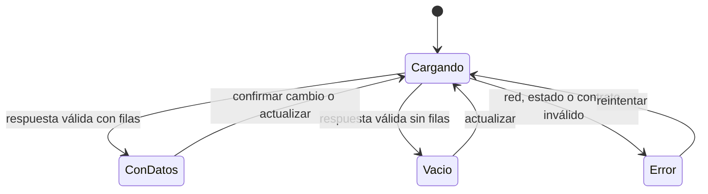

# Clase 15 — Consumo del backend y mutaciones

[[README|Inicio]] · [[Semana3/0 INDICE|Semana 3]] · ← [[Semana3/CLASE 14|Clase 14]] · [[semana4/CLASE 16|Clase 16]] →

> [!abstract] Objetivo
> Leer datos del backend y actualizar la pantalla después de una mutación sin añadir otro gestor de estado.

## Antes de empezar

Repasa [[Semana3/CLASE 14|Clase 14]] y completa su tarea. Consulta [[Recursos/Stack y entorno|Stack y entorno]] y [[Proyecto/1. Sistema de Gestion de Discoteca|Proyecto Discoteca]].

## Desarrollo de la clase

### La interfaz observa información que puede cambiar

El estado del servidor pertenece al sistema compartido: otra persona puede abrir un evento o reservar una mesa después de que cargues la pantalla. La copia que ves es una observación, no la autoridad sobre la disponibilidad actual.

El estado local contiene necesidades de la interacción: texto de un filtro, diálogo abierto o borrador. Distinguir ambas cosas evita usar un almacén global como una copia permanente de toda la base. En el MVP empezamos con fetch y refresco explícito para hacer visible el recorrido.

### Lectura servidor o cliente

Un componente de servidor puede verificar acceso y consultar un servicio directamente. No necesita construir una URL HTTP de sí mismo. Un componente cliente consulta una API cuando su interacción requiere datos durante la sesión del navegador.

Elegir ambos caminos para el mismo listado sin un plan de sincronización crea dos copias difíciles de seguir. La estrategia inicial del curso asigna una fuente clara por pantalla. Después de una mutación, esa fuente debe actualizarse.

### Estados de una lectura



Una respuesta vacía no es un error. Una petición pendiente no es todavía un listado vacío. Mantener estas diferencias evita mostrar «No hay eventos» durante un segundo antes de que lleguen los datos y confundir al usuario.

### Fetch devuelve una respuesta, no datos tipados

La primera promesa resuelve un objeto Response. Después lees su cuerpo con json y validas el contrato. Un estado no exitoso necesita tratamiento antes de interpretar el resultado como una lista. El tipo declarado en tu cliente no obliga al servidor a devolver esa estructura.

`cache: "no-store"` expresa que no queremos reutilizar esa respuesta mediante la caché de la petición. No borra cualquier estado local ni sincroniza por sí sola la pantalla. Una vez que asignaste datos a useState, siguen allí hasta que los cambies o desmontes el componente.

### Elegir una estrategia sencilla

Usaremos fetch, estado local y recarga explícita del listado tras guardar. Los componentes de servidor pueden leer servicios directamente; no mezclaremos dos cachés para el mismo listado. TanStack Query y Zustand quedan como ampliaciones.

### Petición cliente con cancelación

```tsx
"use client";
import { useEffect, useState } from "react";
import { z } from "zod";
const eventListSchema = z.array(z.object({
  id: z.string(), name: z.string(), startsAt: z.string(),
  capacity: z.number(), status: z.enum(["DRAFT", "OPEN", "CLOSED"]),
}));
type EventSummary = z.infer<typeof eventListSchema>[number];
export function EventList() {
  const [events, setEvents] = useState<EventSummary[]>([]);
  const [loading, setLoading] = useState(true);
  const [error, setError] = useState("");
  const [revision, setRevision] = useState(0);
  useEffect(() => {
    const controller = new AbortController();
    setLoading(true); setError("");
    async function load() {
      try {
        const response = await fetch("/api/events", { signal: controller.signal, cache: "no-store" });
        if (!response.ok) throw new Error(`No se pudo cargar (${response.status})`);
        const raw: unknown = await response.json();
        const data = eventListSchema.parse(raw);
        if (!controller.signal.aborted) setEvents(data);
      } catch (error: unknown) {
        if (!controller.signal.aborted) setError(error instanceof Error ? error.message : "Error de conexión");
      } finally { if (!controller.signal.aborted) setLoading(false); }
    }
    void load();
    return () => controller.abort();
  }, [revision]);
  return <section>
    <button onClick={() => setRevision((r) => r + 1)}>Actualizar</button>
    {loading ? <p role="status">Cargando…</p> : error ? <p role="alert">{error}</p> :
      events.length === 0 ? <p>No hay eventos.</p> :
      <ul>{events.map((event) => <li key={event.id}>{event.name}</li>)}</ul>}
  </section>;
}
```

Mover el esquema de respuesta a `features/events/shared` para que sea un contrato común. Las fechas JSON son strings, no objetos `Date`.

### Conectar mutaciones

Elevar `revision` al componente padre. Pasar `onSaved` al formulario; llamarlo solo después de una respuesta exitosa y aumentar revisión para recargar. Así el usuario ve el dato confirmado por servidor. `router.refresh()` no vuelve a ejecutar por sí mismo un efecto cliente con dependencias sin cambios.

Para entradas y ventas no aplicaremos optimistic UI: primero confirmar la operación. Una reserva rechazada con 409 conserva el formulario y explica que la mesa ya no está disponible. Una sesión expirada conduce al login sin tratar el HTML de redirección como JSON válido.

### Seguir el efecto del ejemplo

El efecto crea un AbortController por lectura y se limpia al cambiar revision o desmontar. El bloque load espera la respuesta, comprueba estado, interpreta JSON y valida un array con Zod. Solo entonces publica datos al estado.

La comprobación de signal.aborted impide que una petición cancelada muestre un error de desconexión o cambie el indicador de una lectura nueva. Si el usuario navega a otro evento, no queremos que el resultado lento del anterior sustituya la selección actual.

Abortar fetch no garantiza deshacer trabajo que el servidor ya ejecutó. En lectura sirve para manejar el ciclo de vida del cliente; en una venta no debe usarse como mecanismo de rollback. Si la conexión se corta después de guardar, el backend puede haber confirmado igualmente.

### Actualizar después de guardar

Elevar revision y el callback onSaved a un padre permite conectar formulario y lista. El formulario invoca el callback solo en éxito; la lista vuelve a consultar y muestra la fuente confirmada. No es necesario escribir manualmente una copia con todas las reglas del servidor.

Esta estrategia tiene coste de red y muestra carga; es razonable para el alcance del MVP. Optimistic UI puede mejorar velocidad percibida, pero exige rollback, reconciliación e identidad temporal. No es conveniente improvisarla para una operación de aforo o venta donde un éxito falso tiene consecuencias visibles.

`router.refresh()` actualiza el árbol de componentes de servidor, pero no es una señal universal para volver a ejecutar cualquier efecto cliente. Si tu efecto depende de revision, cambia esa dependencia explícitamente. Si la pantalla usa datos del servidor, define su estrategia de revalidación.

### Una analogía para ubicar cada copia

Abre [[ComoOptimizoMemoria.excalidraw|el dibujo de casa, tienda y supermercado]] y consulta [[Recursos/Conceptos/Cache y sincronizacion#Apoyo visual: casa, tienda y supermercado|su explicación aplicada a las copias de datos]]. Identifica qué dato conserva el navegador, cuál confirma la base y qué condición te haría volver a consultar. La cercanía de una copia no garantiza que esté actualizada.

### Cachés diferentes, problemas diferentes

Puede haber caché del navegador, de una petición del servidor, de datos de un componente o de una librería. «Borrar la caché» es demasiado ambiguo sin identificar qué dato y qué capa conservan el valor. La nota [[Recursos/Conceptos/Cache y sincronizacion|Caché y sincronización]] organiza esas diferencias.

No compartas una caché privada entre usuarios sin considerar identidad y permisos. Una optimización de rendimiento no puede convertirse en una fuga de información. Para el panel inicial elegimos simplicidad y consultas autorizadas antes de añadir almacenamiento reutilizable.

### Un ejemplo de conflicto real

Una pantalla muestra mesa 3 libre. Otra persona reserva mientras el primer usuario rellena el nombre. Al confirmar, la API responde 409. La interfaz debe mostrar que cambió la disponibilidad, conservar datos útiles y recargar mesas. No insistir enviando repetidamente el mismo comando como si fuera un fallo temporal de conexión.

Si la API responde 401, el problema es la sesión. Si el JSON no pasa el contrato, puede haber una desalineación entre versiones de cliente y servidor. Mostrar el mismo texto para todo hace imposible que la persona sepa qué intentar después.

### Comprobaciones para cerrar integración

Con red lenta, observa estado de carga. Navega antes de terminar y comprueba que no aparece contenido de otra selección. Crea un evento y confirma que el listado vuelve a leer. Fuerza error de API y prueba reintento. Finalmente inicia sesión con STAFF y comprueba que el recorrido no necesita un endpoint administrativo al que no tiene permiso.

### Caso desarrollado: llega primero la respuesta de la selección nueva

Abres Evento A y empieza una lectura lenta. Cambias a Evento B, cuya lectura responde rápido. La pantalla muestra B; luego termina A y, sin una comprobación, sobrescribe el estado con datos de A. La API pudo responder correctamente en ambas peticiones y la interfaz seguir siendo incorrecta.

Cada efecto crea su controlador y limpia el anterior al cambiar dependencia. Al abortar o invalidar la lectura vieja, no publica su resultado ni muestra un error como si la conexión actual fallara. El identificador de la selección forma parte de las dependencias que activan la consulta.

No uses una variable global de datos para saltarte ese ciclo de vida. Tampoco agregues una espera fija para intentar que A siempre llegue antes: el orden real de red no está bajo ese control. La solución debe reconocer qué respuesta corresponde a la intención vigente.

Después de guardar un cambio en B, dispara una lectura de B con la señal acordada. Si la pantalla usa useEffect con revision, aumenta revision; si usa un árbol de servidor, aplica su estrategia correspondiente. No mezcles ambos sin identificar la fuente del listado.

Para probarlo, usa red lenta o una demora controlada en un entorno de prueba y cambia rápidamente de selección. El resultado final debe mostrar el recurso seleccionado, incluso cuando las respuestas llegan en orden inverso.

### Complemento: actualizaciones en tiempo real

Además de consultar cuando lo necesitas, una aplicación puede mantener una conexión para intercambiar mensajes con el servidor, como ocurre con WebSockets. Esa ampliación exigiría diseñar autenticación, reconexión y sincronización; no sustituye las reglas de aforo ni los permisos de cada operación.

[[WebSockets.excalidraw|El lienzo de WebSockets]] está reservado para ilustrar esa conversación, pero actualmente está vacío. Por ahora, el flujo de este curso usa peticiones HTTP y actualización explícita del listado. Consulta [[Recursos/Mapa de dibujos Excalidraw#WebSockets: lienzo pendiente|su estado en el índice visual]].

## Práctica guiada

Integrar formulario y listado, y comprobar que una creación aparece sin recargar el navegador.

## Tarea para casa

Completar un flujo real del módulo usando el backend compartido. Añadir reintento y estado vacío.

## Criterios de finalización

- [ ] Se comprueba response.ok.
- [ ] Se cancelan peticiones al desmontar.
- [ ] Una mutación exitosa actualiza el listado.

## Preguntas resueltas

**¿Cancelar fetch deshace una venta?**

No. El servidor puede haberla confirmado; necesitas consultar o reintentar con la misma clave idempotente.

**¿Por qué un listado no cambia después de guardar?**

Puede estar conservado en estado local sin una nueva lectura o señal explícita de actualización.

**¿Todas las cachés se invalidan con router.refresh?**

No. Hay capas diferentes; revisa de dónde proviene realmente el dato de esa pantalla.

## Para profundizar

[React: efectos](https://react.dev/learn/synchronizing-with-effects) · [Fetch](https://developer.mozilla.org/en-US/docs/Web/API/Fetch_API/Using_Fetch).

## Conceptos clave de esta clase

- **Estado del servidor:** Dato compartido cuya fuente de verdad está en el backend.
- **Estado local:** Memoria de interacción de una instancia de interfaz.
- **AbortController:** Mecanismo para solicitar la cancelación de una operación compatible.
- **Revalidación:** Nueva comprobación de datos para sustituir o confirmar una copia.
- **Optimistic UI:** Mostrar provisionalmente un resultado antes de la confirmación del servidor.
- **Reconciliación:** Ajustar la copia de interfaz a la información confirmada.

## Conexiones

[[Semana3/CLASE 14|Clase 14]] · [[semana4/CLASE 16|Clase 16]] · [[Proyecto/4. Arquitectura vertical y contratos|Arquitectura vertical]] · [[Proyecto/5. Evaluacion y entregables|Evaluación y entregables]]


---

[[README|Inicio]] · [[Semana3/0 INDICE|Semana 3]] · ← [[Semana3/CLASE 14|Clase 14]] · [[semana4/CLASE 16|Clase 16]] →
